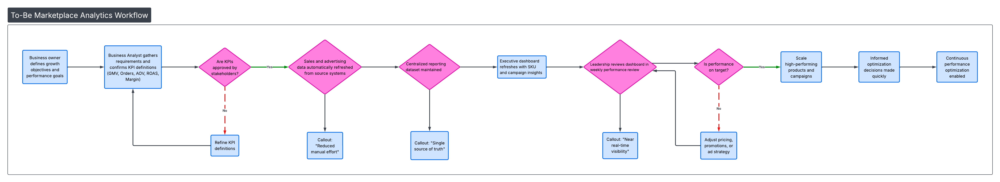

# Amazon Marketplace Analytics

## Overview

This project examines a supplied marketplace transaction extract through reproducible SQL, Excel analysis and a saved Power BI dashboard. Its core questions concern gross merchandise value, platform revenue, weighted take rate, average order value and concentration across sellers and products. The folder also preserves business requirements, process diagrams, delivery registers and UAT examples that explain the original analytical design. A standalone Python runner now loads the local CSV into an in-memory SQLite database and executes the five existing analytical queries without external services. The saved analysis is a portfolio simulation: the Amazon title does not establish access to Amazon systems, production ownership or commercial impact. Findings below describe the supplied extract only.

## Business problem and objectives

Marketplace revenue and merchandise value are different measures. Analysts need consistent denominators, a monthly comparison and clear seller/product breakdowns before recommending changes. The objectives are to reconcile the extract, calculate weighted ratios, identify concentration and provide traceable reporting evidence.

## Technology stack

- Python standard library and SQLite: CSV ingestion, SQL execution and result reconciliation.
- SQL: aggregates, common table expressions, `LAG`, window sums and deterministic ranking.
- Excel workbooks and Power BI `.pbix`: supplied analytical/presentation artifacts.
- Markdown, CSV delivery registers and PNG process diagrams: requirements and traceability.

## Dataset

[amazon_marketplace_aligned.csv](Data/amazon_marketplace_aligned.csv) contains **5,500 rows**, July–December 2025, six categories, four sellers and 80 products. Fields include `OrderDate`, `YearMonth`, `Category`, `Seller`, `ProductID`, `Orders`, `Units Sold`, `GMV`, `Marketplace Revenue`, `Take Rate %` and `AOV`. There is no unique transaction ID; a one-based data-row number supplies local lineage. USD is an inherited portfolio assumption, not independently established currency metadata. Source licensing and real/synthetic provenance are not independently confirmed.

## Architecture and workflow


The PBIX and Excel files are preserved parallel artifacts; the Python runner does not refresh them or implement a cloud warehouse. The original architecture diagram includes proposed systems beyond this local execution scope.

## Data processing and analytical implementation

`scripts/sources.json` maps the original headings to the canonical SQL fields. Required values are checked and numeric fields explicitly parsed. No rows are silently dropped or imputed. Q01 computes controls and ratios of sums; Q02 uses `LAG` for month-over-month GMV; Q03 calculates seller shares; Q04 ranks product contribution with a cumulative window; Q05 drills into category and seller. `NULLIF` protects zero denominators. Both the individual queries and original combined query pack remain available in [SQL](SQL/).

## Dashboard, KPIs and verified findings

The supplied [Power BI report](Dashboard/Amazon_Marketplace_Analytics_Dashboard.pbix) contains one report page with 18 visual containers. Its archive/layout parsed successfully; refresh and DAX execution were not tested on this Mac. Excel contains data, reporting and scenario sheets, including distinct workbook versions preserved rather than assumed duplicates.

Recomputed from the CSV and reconciled with [results](Analysis/RESULTS.md):

| Metric | Value |
| --- | ---: |
| Orders | 5,500 |
| Units | 6,803 |
| GMV | $239,161.36 |
| Platform revenue | $33,393.15 |
| Weighted take rate | 13.9626% |
| Average order value | $43.4839 |
| Largest seller GMV share: Apex Outdoor | 25.3018% |

These are descriptive extract results, not achieved business improvements. Seller shares are fairly close in this sample; the data does not establish why performance differs.

## Visual documentation



The diagram and [historical Jira examples](Jira/) describe planning intent. They do not prove deployed automation or approvals.

## Project structure

```text
Data/        supplied source CSV
SQL/         five queries and combined reference pack
scripts/     portable runner, mapping and validator
Analysis/    supplied result snapshots and profile
Dashboard/   saved Power BI report
Excel/       analytical and delivery workbooks
Docs/        requirements, specifications and runbook
Delivery/    illustrative planning and UAT registers
Diagrams/    process and architecture images
Jira/        historical planning screenshots
Deck/        original executive PDF
```

## Installation and execution

Python 3.10+ with SQLite 3.25+ is sufficient for the local analysis. No third-party Python packages, API keys or cloud services are required.

```sh
python3 scripts/run_analysis.py
python3 scripts/validate.py
```

Run from this project directory. Input paths are resolved from the script location, so execution also works from another working directory. Results are written to ignored `artifacts/`; the supplied `Analysis/` snapshots remain unchanged. The validator compares every Q01–Q05 output field against those snapshots. See [the runbook](Docs/09_Operations_Runbook.md) for failure handling.

## Validation and limitations

All five supplied SQL queries were executed and reconciled locally. Source CSVs are preserved; ingestion validates required columns, numeric types and finite values. This is snapshot reconciliation, not proof of real-world accuracy or stakeholder approval. See [audit results](AUDIT.md).

The original documentation describes a shared Local_System web application, role controls, persistent UAT and transaction history. That application was **not supplied** in this extracted folder. It is not represented as an implemented feature of this standalone copy. Delivery records, proposed approvals and UAT examples remain historical portfolio artifacts. Native application behavior and external integrations require separate testing.

## Attribution and license

The supplied materials identify **Jamie Christian** as their original portfolio author. That authorship, document credits and historical planning evidence are retained. This cleaned copy is prepared for `amrut-mdsh`; it does not claim exclusive authorship or production deployment. No LICENSE was supplied. Public redistribution rights for code, data, dashboards and screenshots must be confirmed separately; see [ATTRIBUTION.md](ATTRIBUTION.md).

## Future improvements

Confirm source rights and business definitions; test Power BI refresh on Windows; supply transaction identifiers and external reconciliation controls before extending this into recurring reporting.
